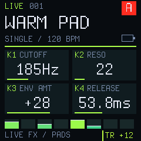
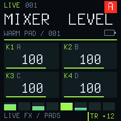
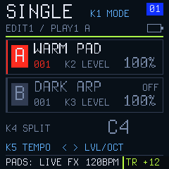
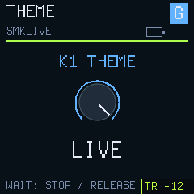

# SMKLIVE — perfil de performance ao vivo

**Testador atualizado V2.1:** [MIDI, PC, GitHub Pages e instalador integrado](SMKLIVE-V2.1-STAGE-LAB.md).

**Versão experimental de código-fonte baseada no SMKSYNTH 1.3.1.** Alvo: M-VAVE SMK-37 Pro ou SMK-37 Elite. Os testes nativos foram executados; o pacote instalável ainda precisa ser compilado com o toolchain JieLi e validado no teclado. Não instale os arquivos `.fwsc` históricos pensando que são SMKLIVE.






As imagens são renderizações do próprio firmware de 240 × 240 pixels, executado no host, não mockups.

## 1. Operação ao vivo

- **Transpose global**: mantenha SEQ pressionado e gire K1 ou pressione ← / →. 25 posições: de −12 a +12 semitons, um semitom por detente. Ambos os botões de seta juntos retornam a 0 quando detectados no mesmo ciclo. O K1 retorna à função da página ao soltar SEQ. O transpose afeta o sintetizador interno, acumula com a oitava do timbre e de split/layer, e não altera os arquivos de timbre. As notas que já estavam pressionadas mantêm sua afinação até o note-off. Notas novas fora de 0–127 são descartadas, não limitadas à nota da borda. Reiniciar retorna o transpose a 0. O indicador TR aparece em todas as páginas do sintetizador com transpose ativo; no LIVE aparece também em zero. O modo independente de controlador MIDI não muda seu mapa nem usa o transpose do sintetizador.
- **Toque curto em SEQ** (< 600 ms, sem usar o modificador): alterna entre o banco de performance/favoritos e o banco LIVE FX. Uma combinação com setas ou K1 não troca o banco. KNOB BANK continua navegando entre Performance/Favoritos → Split/Layer → Scenes/Patterns → LIVE FX → Performance/Favoritos. Um toque longo no KNOB BANK retorna ao primeiro banco.
- **PLAY**: PANIC (kill switch imediato pelo caminho existente). Também mantém o panic anterior GLOBE + PLAY. Libera notas, sustain e HOLD, encerra a reprodução e descarta eventos pendentes. Não apaga patches nem cenas. Não confundir com mute de uma parte. Em INITIALIZE, PLAY mantém sua ação de confirmação original; em telas modais, as ações de confirmação existentes têm prioridade.
- **REC**: liga/desliga o envio de delay da parte selecionada; sem gravação nem apagar trilhas. No banco LIVE FX, as setas sem SEQ navegam pelos presets (exceto páginas dedicadas que possuem outra função para as setas, como Keyboard).
- **Tema**: toque em GLOBE para circular pelas páginas globais até THEME. Gire K1 para escolher OBERVAVE / ZOOM / LIVE. Uma configuração de tema já salva é respeitada; sem preferência válida, o padrão é LIVE. O novo tema usa nomes grandes, identificação da parte, BPM na tela Perform, quatro parâmetros grandes, estado SINGLE/SPLIT/LAYER e medidores animados de envelope das vozes. As telas especializadas (Keyboard, MIDI, Controls, Tempo, Initialize, confirmação de salvamento) preservam o layout funcional e a indicação/acentos do tema; não removemos mensagens necessárias para operações de dados. Os temas antigos continuam disponíveis. Na tela Perform do tema LIVE, PATCH/HOME navega para o mixer, em vez de abrir a antiga tela de osciloscópio. Nos outros temas, o osciloscópio original permanece.

### Banco LIVE FX (pads físicos na ordem numérica original)

| Pad | Função | LED |
| --- | --- | --- |
| 1–4 | Selecionar partes A, B, C, D | cor da parte, destaque na selecionada |
| 5 | Chorus da parte | ciano |
| 6 | Delay da parte | azul |
| 7 | Reverb da parte | verde água |
| 8 | Drive da parte | laranja |
| 9 | Transpose −12 | verde, posição ativa mais intensa |
| 10 | Transpose 0 | verde |
| 11 | Transpose +12 | verde |
| 12 | HOLD do arpegiador da parte | branco |
| 13 | Preset anterior | âmbar |
| 14 | Próximo preset | âmbar |
| 15 | Mute da parte selecionada | vermelho quando silenciada |
| 16 | PANIC / All Notes Off | vermelho |

Efeitos: a ação alterna o send da parte e restaura o último nível do atalho LIVE (quando ainda não existe nível anterior, usa 80/127). Se o retorno compartilhado de chorus/delay/reverb estiver zerado, é ajustado para 48/127; drive também recebe um nível inicial seguro quando zerado. Os knobs/faders normais continuam disponíveis para ajustar o efeito. O efeito pode ter cauda, como no motor original. As ações dos pads são acionadas pelo note-on; o release não repete a ação. O pad 12 é HOLD do arpegiador, não um pedal de sustain. Aftertouch contínuo dos pads não foi acrescentado: o caminho original oferece eventos de pressionamento/velocidade; não foi validado um sinal de pressão contínua no hardware.

### Compatibilidade e recursos retirados

- DRUM-X não é registrado como motor disponível no perfil SMKLIVE, e o transporte do sequenciador/ENDLESS fica desativado. A interface não oferece seus modos de execução. Cenas/patterns permanecem para guardar e trocar timbres, layers e mixer. Os dados e tipos antigos foram preservados para compatibilidade e rollback, de modo que não se afirma uma redução específica de RAM ou latência antes do build/medição no hardware.
- Um patch DRUM-X recuperado de armazenamento é apresentado como INIT ANA em RAM (não reproduz bateria). A versão antiga pode recuperar o patch original a partir do backup, desde que não tenha sido sobrescrito por um SAVE explícito. Exporte seu banco antes da atualização. O tamanho de patch (80 B), de pattern (14476 B) e de som/cena (380 B), a família de dados SMK16P1 e a geometria de flash original foram mantidos. O ajuste de tema utiliza os bytes reservados existentes do registro de mapas MIDI, não um novo setor. Os demais caminhos de persistência continuam manuais como na base.
- A base de código, licenças, presets, instaladores e documentos anteriores foram mantidos. Os workflows de publicação antigos foram movidos para `.github/legacy-workflows/`, para não publicar binários SMKSYNTH como SMKLIVE. Nenhum instalador histórico aponta para o novo pacote.

## 2. GitHub e compilação

1. Extraia este ZIP. Envie o conteúdo da pasta raiz para um repositório novo/branch de desenvolvimento (inclusive `.github`). O GitHub Actions executará `SMKLIVE - native tests` e disponibilizará as renderizações PPM. Não reutilize uma release/tag oficial do SMKSYNTH.
2. Para gerar um `.fwsc`, use Linux x86_64 e o compilador JieLi pi32v2 indicado no projeto original (`sh tools/get_toolchain.sh`). Instale Python 3 e Pillow. Tenha a versão de referência AC79NN SDK V1.2.1 (2023-12-13), com `cpu/wl82/tools/uboot.boot`, `cfg_tool.bin` e `cfg/eq_cfg_hw.bin`. O wrapper verifica o SHA-256 dos três arquivos contra o projeto original e aborta se divergirem.
3. Execute o comando para o modelo correto:

```sh
sh tests/run_smklive_tests.sh
# Escolha SOMENTE uma linha, correspondente ao seu teclado:
AC79_SDK=/caminho/para/fw-AC79_AIoT_SDK ./build-live.sh pro
AC79_SDK=/caminho/para/fw-AC79_AIoT_SDK ./build-live.sh elite
```

Ou abra Actions → `SMKLIVE - experimental update build` → Run workflow. Escolha o modelo, informe a URL HTTPS do repositório oficial do SDK e seu tag/branch/commit de referência. O workflow usa o script de toolchain original e verifica os hashes antes de empacotar. A disponibilidade do SDK e do download externo não foi validada neste ambiente. O workflow não publica releases nem instala nada automaticamente.

Resultados esperados somente após build bem-sucedido:

| Modelo | Identidade experimental | Arquivo em `build/smklive-package/` |
| --- | --- | --- |
| Pro | SMK-37 Pro_19701 | SMKLIVE-1.3.1-live-update-SMK37-Pro.fwsc |
| Elite | SMK-37 Elite_19702 | SMKLIVE-1.3.1-live-update-SMK37-Elite.fwsc |

Os IDs são específicos deste fork, selecionados para evitar reutilizar o ID 19668 da versão original. Não há garantia de aceitação do novo ID no instalador de terceiros. A geração usa o perfil de atualização `--voice-hardware` existente, sem `--first-install` nem seed de fábrica. O script original valida o mapa de memória, tamanho do binário, limites de RAM, loader e regiões privadas da flash. O arquivo `.sha256` acompanha o pacote. O binário final não foi gerado neste ambiente (JieLi/SDK ausentes).

## 3. Recuperação, rollback e roteiro de hardware

**Antes de qualquer instalação**, salve as edições, exporte e verifique um backup do SMKSYNTH original, tenha o firmware de retorno específico do modelo e a ferramenta M-UPGRADE original. Use uma unidade de teste, alimentação USB estável e um cabo de dados conhecido. Não use firmware Pro no Elite ou vice-versa. Não atualize durante uma gravação/restauração pendente. O SMKLIVE é experimental: não use imediatamente em um show.

O caminho original de USB RESCUE está intacto: `firmware/src/platform.c` chama `recovery_key()` antes da inicialização normal (com prioridade para uma restauração pendente na configuração de hardware), `firmware/src/recovery.c` amostra os botões durante 50 ms e `firmware/src/bootguard.h` exige exclusivamente OCTAVE −. O mapeamento físico está em `firmware/hal/smk_input.h` (OCT− bit 4, OCT+ bit 5). Ambos os botões não acionam USB RESCUE, para preservar a calibração. O rescue não inicia áudio nem editor e não grava a flash só por entrar nele. O watchdog original mantém o fallback de recuperação/ROM. **Isso é recuperação em nível de aplicação, não um segundo banco bootável**: se o aplicativo não chegar à rotina inicial, esse atalho não garante recuperar o dispositivo.

Teste primeiro o USB RESCUE na versão original, sem operação pendente: desligue, mantenha apenas OCTAVE − pressionado e religue, até reconhecer USB RESCUE. Saia desligando/religando sem botões, sem enviar um pacote. Repita na versão experimental só depois de validar o build e decidir instalar. O firmware oficial de retorno pode apagar o banco; use o backup. Para o procedimento original, consulte `docs/INSTALLATION.md` e a documentação do fabricante. O instalador público existente não foi modificado para aceitar SMKLIVE; não force uma atualização se a ferramenta não reconhecer o ID/modelo. Não interrompa uma gravação.

### Critérios de validação antes de uso ao vivo

- Boot normal, splash SMKLIVE e boot com OCT− mantido, incluindo USB detectado.
- Pitch: todos os três estados e combinações físicas, soltura do botão durante giro de K1, mudança com acordes/sustain, split/layer, MIDI por parte, oitava original, extremos da faixa.
- Todos os 16 pads e LEDs, alternância de bancos, troca de timbres, favoritas/cenas e restore, efeitos, mute, panic em áudio real e sustain.
- As três aparências em todas as páginas, medidores em acordes, rapidez do painel e ausência de áudio entrecortado/overruns.
- Após backup, teste o retorno à versão original e a restauração em unidade de teste. Não force a instalação ou recuperação de um modelo diferente.

## 4. Validação executada no ambiente de desenvolvimento

`tests/smklive_test.c` testa modificador e detentes na soltura, note-off após transpose, split/layer, notas fora da faixa, MIDI secundário, banco e ações dos 16 pads, efeitos, HOLD, mute, panic, transporte e engine retirados, formatos de dados, seletor de recuperação e os três temas com o indicador. Os testes legados de physical controls, octave, MIDI return tuning, SU3 workflow, sustain panic, split layer e zoom palette passaram no perfil original. O verificador de fronteira MMIO/HAL passou. A ausência do compilador e SDK bloqueou a compilação de hardware e qualquer teste físico; os testes nativos não provam o comportamento elétrico/latência do instrumento nem a aceitação da atualização USB.

## 5. Créditos e licença

Fork experimental do SMKSYNTH/OberVave. Preservados `LICENSE`, `CREDITS.md`, `LICENSING.md`, avisos SPDX e autores do código base. As mudanças SMKLIVE também mantêm GPL-3.0-only.
